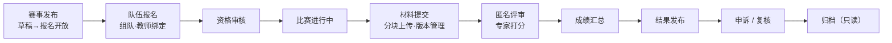

# 数学建模比赛管理系统 · 软件工程课程项目

> 浙江树人学院《软件工程》2026-2027 学年第一学期 ｜ 指导教师：丁健龙 ｜ 两人组
> 赛道方向：8 校园电子商务 ｜ 当前主线：**数学建模比赛管理系统**

---

## 这个仓库是什么

课程 6 次实验的交付物，以及比赛平台的设计文档。

2026-10-28 做过一次**方向切换**：从「数学建模论文评审与优化服务平台」切换为「数学建模比赛管理系统」。旧方向的全部内容已归档到 [`archive/`](archive/README.md)，不再更新，也不再作为后续实验的基础。

---

## 主线：数学建模比赛管理系统

### 平台要解决的问题

校内/校际数学建模竞赛目前靠微信群 + 邮箱 + Excel 管理：报名靠填表、论文靠邮件收、评审靠线下传阅、结果靠手动汇总。这个平台把它做成一条完整的线上流程。

### 业务主链路

### 四类用户

| 角色 | 核心诉求 |
|---|---|
| 学生（队长 / 队员） | 找比赛、组队报名、提交作品、看成绩 |
| 教师（指导教师） | 绑定队伍、查看指导队伍进展 |
| 评委（评审专家） | 领任务、匿名阅读、按细则打分 |
| 平台管理员 | 配置赛事与规则、分配评审、发成绩、处理申诉、看审计 |

### 技术方向

**纯 Python 后端**：FastAPI + SQLAlchemy 2.0 async + asyncpg + PostgreSQL 16 + Redis 7 + Celery + MinIO，前端 React 18 + Vite + TypeScript + Ant Design 5。

设计原则是「模块化单体起步，但每一层都留好高并发扩展位」——单机跑得动，压力来时加机器而不是改代码。详见 [技术选型（纯 Python）](competition-management/docs/tech-stack/tech-stack-python.md)。

### 评审环节的设计取舍

这是本项目相对普通「比赛报名系统」的核心差异点：

| 阶段 | 谁来做决定 | 关键约束 |
|---|---|---|
| ① AI 预评级 | 模型给出**参考分 + 置信度 + 证据引用 + 风险标记** | 异步、可重跑、结果留档；`authority = ADVISORY`，**永不进入最终成绩加权** |
| ② 人工打分 | 专家 | 默认隐藏 AI 分数只给风险清单（防锚定）；可配置并列展示但要填分歧理由 |
| ③ 边界复审 | **确定性规则引擎**，不是模型 | 专家分差、AI-人工分差、置信度、风险确认、奖项边界五条规则，阈值进 `rule_profile` 可版本化 |

一句话：**AI 是路由器，不是评委。**

---

## 目录地图

| 路径 | 内容 | 状态 |
|---|---|---|
| [`competition-management/`](competition-management/README.md) | ★ 当前主线全部内容 | 活跃 |
| [`competition-management/docs/`](competition-management/docs/) | 平台愿景、系统边界、功能需求、技术选型 | 活跃 |
| [`competition-management/experiments/`](competition-management/experiments/) | 实验一～实验六交付物 | 进行中 |
| [`competition-management/ai-log/`](competition-management/ai-log/README.md) | 跨实验 AI 使用记录汇总口径 | 活跃 |
| [`软件工程实验资料/`](软件工程实验资料/) | 课程官方指导书、报告模板、评分标准、授课计划 | 只读参考 |
| [`实验二（材料）/`](实验二（材料）/) | 实验二官方材料与课件 | 只读参考 |
| [`archive/`](archive/README.md) | 历史方向与散落文件的归档区 | 冻结，不再维护 |

---

## 当前进度

| 实验 | 主题 | 交付物 | 状态 |
|---|---|---|---|
| 实验一 | 功能性需求分析 | [exp1-功能性需求分析](competition-management/experiments/exp1-功能性需求分析/README.md) | ✅ 完成 |
| 实验二 | 业务对象识别与用例图建模 | [exp2-业务对象识别与用例图建模](competition-management/experiments/exp2-业务对象识别与用例图建模/README.md) | ✅ 完成 |
| 实验三 | OOD 系统架构 / MVP / 类图 | [exp3-OOD架构与MVP](competition-management/experiments/exp3-OOD架构与MVP/) | ⬜ 待开始 |
| 实验四 | 人机协同开发 · AI 代码生成 | — | ⬜ 未开始 |
| 实验五 | 人机协同开发 · AI 代码评审 | — | ⬜ 未开始 |
| 实验六 | 人机协同开发 · 综合交付 | — | ⬜ 未开始 |

---

## 阅读顺序

刚接手这个仓库，按这个顺序看：

1. **[平台愿景初稿](competition-management/docs/平台愿景初稿.md)** — 一页纸看清有哪些模块（登录注册 / 赛事中心 / 个人中心）
2. **[系统边界](competition-management/docs/boundary.md)** — 系统管什么、不管什么，生命周期与权限边界
3. **[功能需求 FR-001～FR-028](competition-management/docs/functional-requirements.md)** — 带优先级和验收条件的完整需求表
4. **[技术选型（纯 Python）](competition-management/docs/tech-stack/tech-stack-python.md)** — 架构、数据库、高并发设计、压测方案
5. **[实验一](competition-management/experiments/exp1-功能性需求分析/README.md)** → **[实验二](competition-management/experiments/exp2-业务对象识别与用例图建模/README.md)** — 已交付的过程材料

---

## 约定

| 项 | 约定 |
|---|---|
| 组别口径 | 两人组（成员 A 需求分析兼记录、成员 B 产品设计与文档） |
| AI 使用记录 | 每次实验的 `ai_log.md` 记录提示词与产出；`ai_audit.md` 记录人工核对结论 |
| 文档命名 | 主线文档用英文 kebab-case；课程交付物保留中文原名 |
| 归档规则 | 方向切换或阶段性废弃的内容进 `archive/`，不删除、不再修改 |
| 大文件 | 超过 20MB 的二进制资产不纳入版本控制（见 `.gitignore`） |

---

## 相关链接

- [归档区说明](archive/README.md) — 旧方向「论文评审平台」的全部内容与恢复方法
- [技术选型对比留档](competition-management/docs/tech-stack/tech-stack-ts.md) — 早期 TypeScript 方案的评估记录（已被纯 Python 方案取代）
