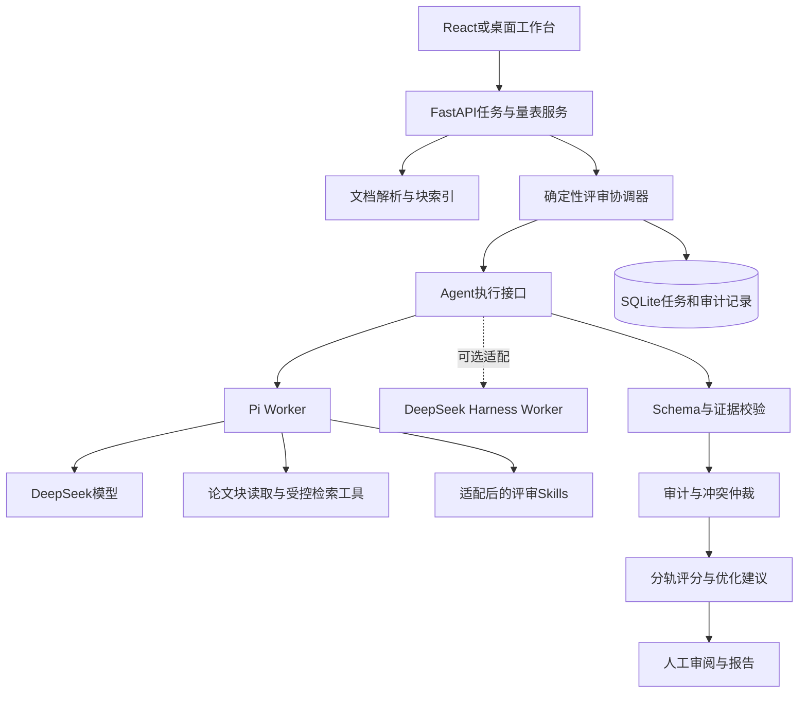

# 数学建模论文评审与获奖等级预测系统：可行性分析与实施方案

分析日期：2026-10-14。参考用户提供的55页用户说明书，以及本地 `D:/project/githubclone/Evaluation-of-Mathematical-Modeling-Papers` 的源码、协议和交接资料。文档中的操作指引仅作为参考系统的描述。本次只分析，不修改参考项目、不安装或运行公开 Agent。

## 1. 结论

适合以已有评审工作台为基础，保留 Python 后端、前端、数据库和确定性状态机，用 DeepSeek 模型承担语义分析，用 Pi 承担受控的工具调用和评审会话。先补齐“评审—证据核验—建议—人工审阅—报告”的闭环，再研究获奖等级预测。

实现评审辅助系统具有较高技术可行性；实现稳定、可校准的获奖等级预测，取决于真实标注数据和跨年份验证。接入 Agent 本身不能证明预测准确。

当前推荐：**现有系统 + Pi 独立 Worker + DeepSeek + 项目内适配后的评审 Skill**。DeepSeek Harness 保留为可替换执行引擎。这个选择依据本项目 Python 主体、已有结构化协议和单用户桌面定位，不是对两种 Harness 的实测性能排名。

## 2. 参考说明书的功能及取舍

说明书第3—7页定义导入、特征提取、任务队列、多模型融合、校准、建议、审计和监控；第20页列举 XGBoost、LightGBM、CatBoost、TextCNN；第28—32页采用规则和模板生成建议。

| 功能 | 首版建议 | 实现条件 |
|---|---|---|
| PDF/DOCX导入、批次管理 | 保留 | 分块解析、文件指纹、错误隔离 |
| 摘要/建模/求解/验证分析 | 保留并细化 | 使用现有七阶段协议、引用原文块 |
| 任务进度、历史、人工修改、导出 | 保留 | 用现有后端与存储承接 |
| 四种监督模型融合 | 后置 | 需要训练数据、模型文件、独立评测 |
| 获奖置信度校准 | 后置 | 需要留出校准集，不接受LLM自报概率 |
| 规则与模板建议 | 与LLM结合 | 规则识别明确缺项；模型提出具体改进 |
| 审计与监控 | 首版简化 | 实际记录阶段、耗时、错误、调用与版本 |

说明书的截图数值不能作为性能或准确率证据。第33页120ms告警阈值也不适合作为云端多轮论文评审的端到端目标。应区分界面接口延迟、排队时间和完整评审时间，后者通过真实样例测量。

## 3. 已有项目可以复用什么

根据源码和2026-10-07交接资料：

- 已有 FastAPI、SQLite、React 工作台及 Windows 桌面启动器。
- `automatic_runner.py` 顺序执行七阶段，保存进度和结果，校验引用的资产、块ID及页码等定位。
- `llm_adapter.py` 支持 OpenAI-compatible 请求、JSON解析及Pydantic校验，但没有工具调用循环。
- 已有官方评分与通用诊断分轨、人工发布量表、证据对象、强结论降级和确定性生命周期。
- `config/skill_registry.yaml` 的外部条目是 `reference_candidate`；复制进目录不等于运行时启用。
- `config/agent_roles.yaml` 明确是研发协作角色，不是产品评审运行时角色。

尚缺：正式证据审计与仲裁的自动执行、正式官方评分与优化建议的自动生成、受控检索和来源保存、真实模型评审质量验证。交接资料中的历史测试通过不证明本次重新测试，也不证明真实模型质量。

另一个值得优先修复的问题：当前 `build_context()` 按顺序截取最多120000字符，正文尾部可能被截掉，证据目录却包含全部块。应让Agent按章节/块检索原文，明确记录已读取的块与覆盖范围，不能让未读取的块成为强结论依据。

## 4. DeepSeek、Pi与Harness怎么分工

| 方案 | 适用情形 | 本项目判断 |
|---|---|---|
| 直接调用DeepSeek兼容接口 | 输入预先整理、固定步骤评审 | 最小改动，可用于第一轮基线 |
| Pi + DeepSeek | 按需读章节、查证据、加载Skill、保存过程 | 推荐作为首个Agent引擎 |
| DeepSeek Harness + DeepSeek | 希望通过插件组织模型、工具、会话与执行循环 | 可行，但首版集成与版本适配范围更大 |

Pi官方文档提供print、JSON事件、RPC和TypeScript SDK；DeepSeek可通过 `DEEPSEEK_API_KEY` 配置。Python后端优先使用RPC子进程；如果使用SDK，另建Node Worker，通过内部服务接口连接Python。

DeepSeek Harness官方CLI支持headless、JSON事件及ACP等接入方式；官方README仍标明developer preview及可能破坏兼容性。两种引擎都应锁定版本并封装适配器。

参考：[Pi CLI集成](https://pi.dev/docs/latest/cli-integration)、[Pi SDK](https://pi.dev/docs/latest/sdk)、[Pi模型提供商](https://pi.dev/docs/latest/providers)、[DeepSeek Harness](https://github.com/deepseek-ai/deepseek-harness)、[Harness CLI](https://github.com/deepseek-ai/deepseek-harness/blob/master/docs/cli-help.md)。

注意：JSON事件模式只保证事件以JSONL传输，不保证模型最终评审内容符合业务Schema。必须提取最终结果，执行Pydantic校验和证据核验。RPC传输确认也不等于任务成功完成。

## 5. 推荐架构

项目后端负责资产版本、任务身份、生命周期、评分聚合与发布。Agent负责提出分析结论、查阅证据和生成候选建议。模型输出不直接写最终状态，也不自行确认官方量表。

新增统一执行协议，例如 `evaluate_stage / audit_evidence / generate_recommendations`。保留现有 `StageResult` 作为阶段输出，增加引擎版本、模型ID、Skill版本、输入哈希、读取范围、工具调用、耗时和用量字段。先保留直接API执行器作为对照，再新增Pi执行器；不必第一轮同时支持两种Harness。

## 6. 主体分析的具体流程

1. 上传论文、赛题、官方量表；有代码和数据时仅索引与静态阅读。
2. 解析并冻结资产，生成页码/段落/块ID索引；扫描件进入OCR，关键公式和图表解析不足时标记待核实。
3. 执行七阶段：问题识别、问题表述、假设、模型构建、求解、代码实现、结果分析。阶段输出问题、理由、评分候选、义务和证据引用。
4. 独立核查引用是否存在、原文是否支持判断、图表数字是否一致、结论适用范围是否明确。
5. 只对冲突或高影响判断触发复核；同一模型换角色产生的共识不是独立验证。
6. 按已发布量表生成评分，保留通用诊断分轨。缺证据时返回无法判断，不能把未执行的代码写成已验证。
7. 生成建议并绑定Finding：问题、页码、修改动作、优先级、验收方法；人工修改后留存版本历史。
8. 输出报告，支持上传修改稿后检查旧问题的解决状态。

建议Worker只暴露必要的自定义工具：`get_paper_outline`、`read_paper_blocks`、`search_paper_blocks`、`read_rubric`、`lookup_reference`。首版不要开放任意bash、文件改写或代码执行；禁用默认MCP发现和无关扩展，工具服务按任务限制资产范围。Skill中的脚本必须单独审查、适配，不能因模型读取Skill就自动获得执行权限。

## 7. 公开Skill与Agent参考

优先利用参考项目已经保存的上游快照和来源清单，便于锁定提交与核对许可。以下前五项来自本地来源矩阵；后两项为本次联网核对的补充。

| 来源 | 可复用内容 | 本系统落点 |
|---|---|---|
| [LLM-MM-Agent](https://github.com/YiFraternity/LLM-MM-Agent) | 七阶段评价框架 | 现有阶段评审 |
| [MathModelingAgent](https://github.com/yohanchen1/MathModelingAgent) | Claim—Obligation—Evidence、结论强度 | 证据审计 |
| [MathModeling-skills](https://github.com/zhnnky329/MathModeling-skills) | 一致性、完整性、稳健性检查 | 专项评审Skill |
| [research-paper-lifecycle-skills](https://github.com/ShaishavMaisuria/research-paper-lifecycle-skills) | verify-claims主张核验 | 过度主张与数字核对 |
| [Agentic Paper Review](https://github.com/ngstcf/agentic-paper-review) | 专家评审、事实核查、综合角色 | 运行时角色拆分 |
| [CMU Paper Reviewer](https://github.com/prometheus-eval/cmu-paper-reviewer) | PDF解析—Agent评审—报告管线，评测入口 | 全流程及质量评测参考 |
| [paper-reviewer](https://github.com/sohan-shingade/paper-reviewer) | issue ID、跨版本状态跟踪、综合评审 | 修改前后对比设计参考 |

CMU项目采用OpenHands等具体依赖；paper-reviewer面向Claude Code。可以借鉴流程与协议，不能假设直接拷贝即可在Pi或DeepSeek上运行，也不能把通用学术审稿评分直接当成数学建模奖项标签。

首批只适配3项：主张核验、一致性审计、稳健性检查。每项约定输入Schema、输出Schema、证据ID、缺证据行为与版本；不要一次装入全部写作/建模技能。评审与改写论文应分开。

## 8. 获奖等级预测为什么应单独做

通用诊断分数、基于官方标准的辅助评分、实际获奖概率是三个不同输出。没有历史标签时，可以报告“基于当前量表的等级参考”，不能报告经过校准的获奖概率。

有真实数据后：限定竞赛、组别和奖项体系；保留年份、赛题、真实奖项、论文版本；包含未获奖样本；清除标题/文件名/水印里的奖项泄漏；同队同稿不跨训练测试集；按年份和赛题分组验证。先比较简单基线和一个分类器，效果支持后再考虑融合。对概率做独立校准，用macro-F1、各等级召回率、混淆矩阵、Brier/ECE等指标评价，并观察新年份退化。

数十篇样例适合发现解析与建议问题，通常不足以证明跨赛题获奖预测可靠。所需训练规模应根据类别、学习曲线和验证结果确定。

## 9. 开发顺序与验收

以下为熟悉Python/React、可兼职或全职开发情况下的粗略人日估算，不包含获得标注数据、模型训练和复杂OCR：

| 阶段 | 工作 | 粗估 | 可验收结果 |
|---|---|---|---|
| 1 | 现有API接DeepSeek，真实论文基线 | 1—3人日 | 阶段结果可解析、引用可定位、失败可恢复 |
| 2 | 自动证据审计、分轨评分、建议闭环 | 5—10人日 | 不伪造已验证结论，建议绑定实际问题 |
| 3 | Pi RPC Worker、受控工具、3个Skill | 4—8人日 | 按需读取、进度回传、超时终止、任务隔离 |
| 4 | 修改稿复审、评测与桌面集成 | 4—8人日 | 问题可追踪、真实样例可复跑、报告可审阅 |
| 后续 | 标签采集、等级预测及校准 | 另行估算 | 独立测试集上的预测和概率指标 |

先用同一批样例比较“直接API”和“Pi+Skill”，观察重大问题发现率、错误指控率、证据引用正确率、建议可执行性、重复运行差异、耗时与成本。建议邀请教师标注一批覆盖缺证据、公式提取失败、伪引用、结论过度、结果矛盾等情况的论文，作为评测集。

成本按实际输入/输出token、模型价格、重试、OCR和检索次数计算。先跑5—10篇记录P50/P95耗时与单篇费用，再确定并发和预算。不预设单篇固定成本或完整分析的毫秒级时延。

## 10. 课程可行性分析可采用的表述

技术可行性：现有系统已具备文档解析、结构化评审、持久化与交互基础，新增Agent执行器和评审Skill能支撑受控工具调用；主要难点为证据核验、文档解析质量和奖项预测验证。

经济可行性：首版复用既有工作台和公开组件，采用本地部署与云端API降低训练及算力投入；主要持续成本是模型调用、OCR及维护，通过样例测量确定预算。

操作可行性：教师和参赛者可沿上传、选择量表、查看问题与建议、人工审阅、导出报告的流程使用，复杂参数放在高级设置。

进度可行性：优先完成单篇评审闭环，再扩展批次、复审和预测，能形成阶段性可演示成果。

数据可行性：论文诊断可以依托论文和量表启动；可靠奖项预测需要额外的历史标签，当前没有证据表明这些数据已具备。

明确的第一项开发任务：用现有兼容模型接口建立真实论文基线，补齐证据审计和建议生成，再通过统一执行器加入Pi Worker。产品目标建议先定为“数学建模论文评审与优化建议系统”，奖项预测作为可验证的扩展能力。
