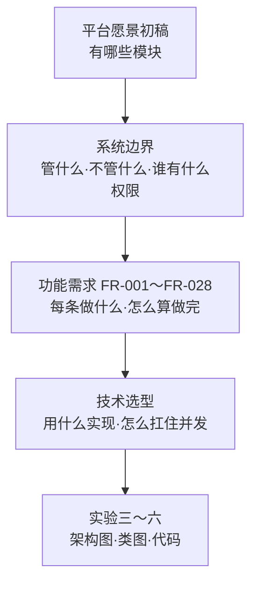

# docs · 设计文档

> 比赛平台的设计文档。四份主线文档 + 一份选型对比留档。

---

## 文档清单

| 文档 | 内容 | 读者 |
|---|---|---|
| [平台愿景初稿](平台愿景初稿.md) | 模块划分一页纸：登录注册 / 赛事中心 / 个人中心 / 首页 / 关于我们 | 所有人，尤其第一次接触项目 |
| [系统边界](boundary.md) | 系统边界、12 态生命周期、权限边界、角色、数据、风险 | 需求与架构设计 |
| [功能需求](functional-requirements.md) | FR-001～FR-028 + 非功能需求 + 异常场景 + 优先级 + 验收条件 | 开发、测试 |
| [技术选型（纯 Python）](tech-stack/tech-stack-python.md) | ★ 采用方案：架构、数据库、文件上传、AI 评审、高并发、压测、部署 | 开发、运维 |

对比留档：

| 文档 | 状态 |
|---|---|
| [技术选型（TypeScript）](tech-stack/tech-stack-ts.md) | 早期评估记录，已被纯 Python 方案取代，仅作决策依据留档 |

选型关系与取舍结论见 [tech-stack/README.md](tech-stack/README.md)。

---

## 文档之间的关系

读的时候按箭头走，不要跳。功能需求里每条 P0 项在边界文档里都有对应的权限与生命周期约束，技术选型里都有对应的模块落点。

---

## 三份核心文档的要点速查

### 平台愿景初稿

5 个模块。其中**赛事中心**是主干（赛事介绍 → 通知公告 → 参赛咨询 → 报名 → 提交作品 → 我的成绩），**个人中心**承接「我的竞赛」四种状态（关注 / 已报名含倒计时 / 比赛中 / 已结束）。首页与关于我们待定。

### 系统边界

- 生命周期 **12 态**，每态有明确的进入条件与离开条件
- 6 类角色：赛事管理员 / 评审专家 / 指导教师 / 队长 / 队员 / 系统运维
- 匿名评审：专家看到的材料不含队伍、学校、指导教师
- 归档后只读

### 功能需求

28 条，分三级：

| 级别 | 含义 | 数量 |
|---|---|---|
| P0 | MVP 必须做，缺了系统跑不通 | 报名、提交、评审主线 |
| P1 | V1 完整版 | 申诉、导出、统计 |
| P2 | V2 增强 | 协作、进阶报表 |

每条都带验收条件，写测试时直接对着抄。

---

## 技术选型的三条不可动摇的决策

如果只记三件事，记这三条：

1. **全 async**。所有路由 `async def`、所有 DB 调用 `await`、所有 CPU 密集任务进 Celery。混入同步代码会让 worker 事件循环假死，表现是并发超过某点后延迟线性上升。
2. **AI 不进加权**。预评级 `authority = ADVISORY`，只做分流与风险提示；边界复审由确定性规则引擎触发，阈值进 `rule_profile` 可版本化。
3. **六条唯一约束进迁移**。`(competition_id, team_name)`、`(competition_id, user_id)`、`(task_id, reviewer_id)`、`(asset_id, version_no)`、`(md5, size_bytes)`、`(version_id, model_id, prompt_version, input_hash)`。缺一个压测必挂。

---

## 维护约定

| 项 | 约定 |
|---|---|
| 命名 | 英文 kebab-case，中文标题写在文档第一行 |
| 版本 | 文档头部写版本号与日期；重大改版升大版本 |
| 交叉引用 | 用相对路径 Markdown 链接，不用绝对路径 |
| 图 | 能用 mermaid 就不用图片，便于 diff |
| 归档 | 被取代的文档移入仓库根目录的 `archive/`，不留在 `docs/` 里 |
