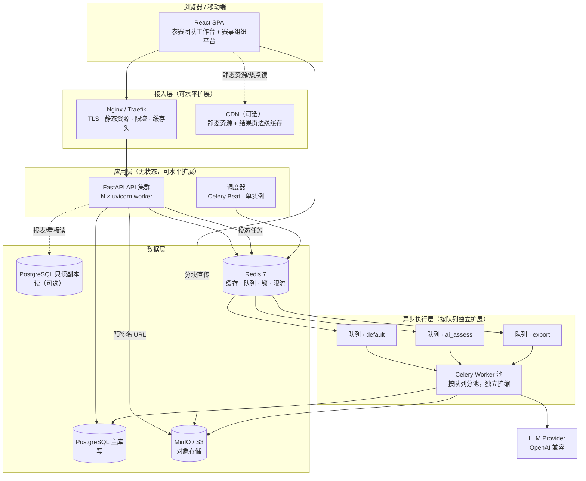
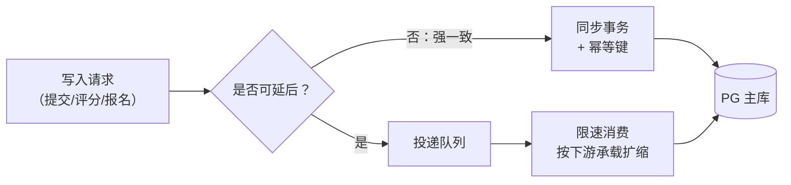

# 数学建模比赛管理系统 技术栈方案（纯 Python）

> 版本：v2.1 ｜ 语言约束：**后端全部 Python**，前端 TypeScript ｜ 规模目标：校内起步，**架构需支持横向扩展到万级并发读、千级并发写**
> 依据：[平台愿景初稿](../平台愿景初稿.md)、[系统边界](../boundary.md)、[功能需求](../functional-requirements.md)（FR-001～FR-028）、[业务对象](../../experiments/exp2-业务对象识别与用例图建模/business_objects.md)（17 个业务对象）
> 团队规模：2 人（两人组） ｜ 课程节奏：实验三～实验六（人机协同开发）

---

## 0. 结论速览

**模块化单体起步，但每个边界从第一天就按「可拆、可扩、可缓存」设计**，而不是先写单体再谈高并发。

| 层 | 选型 | 版本 |
|---|---|---|
| 前端 | React + Vite + TypeScript + Ant Design 5 + TanStack Query | 18 / 5 / 5.x |
| API 框架 | FastAPI + Uvicorn（多 worker） | 0.115+ |
| 业务运行时 | **全 async**：SQLAlchemy 2.0 async + asyncpg | 2.0 / 0.29+ |
| 数据校验 | Pydantic v2 + pydantic-settings | 2.7+ |
| 数据库 | PostgreSQL 16 | 16 |
| 缓存 | Redis 7（缓存 + 队列 + 分布式锁 + 限流） | 7 |
| 异步任务 | Celery 5 + Redis broker（或 ARQ，见 §6.2） | 5.4+ |
| 对象存储 | MinIO（S3 兼容） | latest |
| 文档处理 | PyMuPDF + python-docx + Pillow | 1.24+ / 1.2 / 12.x |
| 部署 | Docker Compose → 可平滑迁移 K8s | — |
| 观测 | structlog + prometheus-client + OpenTelemetry（可选） | — |

**核心原则**：单机跑得动，但**每个未来会热的点都有明确的扩展路径**（读写分离、缓存层、队列削峰、分片、CDN）。见 [§9 高并发设计](#9-高并发设计总纲)。

---

## 1. 架构总览

### 1.1 逻辑分层



### 1.2 无状态是扩展的前提

| 约束 | 具体做法 |
|---|---|
| API 进程不存会话 | JWT（`httpOnly` cookie 或 `Authorization`），无需 Redis session |
| 不存本地文件 | 一期即用 MinIO，禁止 `UPLOAD_DIR` 落地业务文件 |
| 不在进程内做定时 | 统一交给 Celery Beat，避免多实例重复执行 |
| 不依赖进程内锁 | 用 Redis 分布式锁（Redlock 或单实例 SET NX PX） |
| 请求幂等 | 关键写接口带 `Idempotency-Key`，Redis 记录结果 |

满足这五条，`uvicorn --workers N`、多容器、后续迁 K8s 都不需要改业务代码。

---

## 2. 前端技术栈

| 项 | 选型 | 版本 | 理由 |
|---|---|---|---|
| 框架 | React | 18.3 | 生态与 AI 生成质量最佳 |
| 构建 | Vite | 5.4 | 秒级冷启动，产物可 CDN |
| 语言 | TypeScript | 5.4 | 由后端 OpenAPI 自动生成类型（`openapi-typescript`） |
| 组件库 | Ant Design | 5.x | 表格/表单/上传/时间线密集型后台刚需 |
| 数据层 | TanStack Query | 5.x | 缓存失效、轮询、乐观更新；**高并发下减少前端重复请求** |
| 路由 | React Router | 6.x | 角色路由 + 权限守卫 |
| 图表 | ECharts | 5.x | 评审进度看板、成绩分布 |
| 请求 | axios / fetch 封装 | — | 统一重试、取消、错误码映射 |
| 表单 | React Hook Form + Zod | 7.x / 3.x | 即时校验，减少无效请求 |
| 测试 | Vitest + Playwright | 1.x / 1.4x | 关键链路冒烟 |

### 2.1 前端也必须为高并发让路

| 手段 | 说明 |
|---|---|
| 静态资源 CDN + 强缓存 | `index.html` 短缓存 + 哈希文件名长缓存 |
| 结果页 ETag / `If-None-Match` | 成绩公布瞬间全校刷新，命中 304 不查库 |
| TanStack Query `staleTime` | 赛事列表 30s、成绩页 60s，避免重复拉取 |
| 长列表虚拟滚动 | 报名表、评审名单用 `@tanstack/virtual` |
| 断点续传 | 上传器按 `chunkIndex` 记录，刷新后可续 |
| 轮询退避 | 评审进度用指数退避（1s→30s），不用固定 1s 轮询 |

### 2.2 目录结构（与后端模块对齐）

```
apps/web/
├── src/
│   ├── app/                # 路由装配、Provider、错误边界
│   ├── features/
│   │   ├── auth/           # 登录注册、角色路由
│   │   ├── competition/    # 赛事中心、通知公告、参赛咨询
│   │   ├── enrollment/     # 报名、队伍、教师绑定
│   │   ├── submission/     # 分块上传、版本列表、倒计时、回执
│   │   ├── review/         # 评审工作台、匿名材料阅读器、评分表
│   │   ├── assessment/     # AI 预评级结果与风险标记（按角色可见性）
│   │   ├── result/         # 我的成绩、排名、评语
│   │   ├── appeal/         # 申诉单与处理进度
│   │   ├── profile/        # 个人中心、我的竞赛（关注/已报名/比赛中/已结束）
│   │   └── admin/          # 赛事配置、评审分配、进度看板、审计、导出归档
│   ├── shared/             # 组件、hooks、API client、生成类型
│   └── styles/
```

---

## 3. 后端技术栈（全 Python）

### 3.1 核心选型

| 项 | 选型 | 版本 | 理由 |
|---|---|---|---|
| 语言 | Python | 3.12 | 性能优于 3.11（约 5–10%），生态完整 |
| ASGI 服务器 | Uvicorn | 0.30+ | 配合 `uvloop` + `httptools` |
| 可选加速 | Gunicorn + UvicornWorker | 21+ | 进程管理更成熟，便于平滑重载 |
| Web 框架 | FastAPI | 0.115+ | 异步、依赖注入、OpenAPI |
| ORM | **SQLAlchemy 2.0 async** | 2.0 | 全 async，`asyncpg` 驱动 |
| 驱动 | asyncpg | 0.29+ | 比 psycopg 快，原生 async |
| 迁移 | Alembic | 1.13+ | 版本化 DDL |
| 校验 | Pydantic v2 | 2.7+ | Rust 内核，性能显著 |
| 配置 | pydantic-settings | 2.4+ | 启动即校验环境变量 |
| 鉴权 | python-jose / PyJWT + passlib + **argon2-cffi** | — | 密码用 Argon2id |
| 权限 | 自研 `PolicyGuard` 依赖 | — | 角色 × 赛事 × 对象三层 |
| 任务队列 | Celery 5 + Redis | 5.4+ | 按队列分池、可观测 |
| 缓存 | redis-py（async） | 5.x | 缓存/队列/锁/限流四合一 |
| HTTP 客户端 | httpx（async） | 0.27+ | 调 LLM，支持超时/连接池 |
| 日志 | structlog | 24+ | 结构化 JSON，`traceId` 贯通 |
| 观测 | prometheus-client | 0.20+ | `/metrics` 暴露关键指标 |
| 文档 | FastAPI 内置 OpenAPI | — | 前端自动生成类型 |
| 测试 | pytest + pytest-asyncio + httpx.AsyncClient | 8.x | 异步测试 |
| 压测 | Locust 或 k6 | — | 见 §11 |

### 3.2 目录结构

```
apps/api/
├── src/cm/
│   ├── main.py                 # FastAPI 应用装配
│   ├── core/
│   │   ├── config.py           # pydantic-settings
│   │   ├── security.py         # JWT、Argon2
│   │   ├── deps.py             # 依赖注入：db session、current_user、policy
│   │   ├── errors.py           # 业务错误码 + 全局异常映射
│   │   ├── logging.py          # structlog 配置、traceId 中间件
│   │   └── metrics.py          # Prometheus 指标
│   ├── db/
│   │   ├── session.py          # async engine、sessionmaker、读副本路由
│   │   ├── base.py             # 声明式基类、AuditMixin
│   │   └── migrations/         # Alembic
│   ├── infra/
│   │   ├── cache.py            # Redis 客户端、缓存装饰器
│   │   ├── lock.py             # 分布式锁
│   │   ├── ratelimit.py        # 令牌桶（Redis + Lua）
│   │   ├── storage.py          # StorageProvider: LocalDisk | S3
│   │   └── llm.py              # LLM 客户端（超时/重试/熔断）
│   ├── modules/
│   │   ├── identity/           # User, Role, AdvisorBinding
│   │   ├── competition/        # Competition, RuleProfile, Announcement, ProblemSet
│   │   ├── enrollment/         # Team, Enrollment
│   │   ├── submission/         # Blob, Asset, Version + 三段式上传
│   │   ├── review/             # ReviewTask, RubricProfile, ScoreRecord, 匿名投影
│   │   ├── assessment/         # AIPreAssessment, ReviewEscalation
│   │   ├── result/             # CompetitionResult, Award, 汇总
│   │   ├── appeal/             # Appeal, AppealAction
│   │   ├── audit/              # AuditLog 切面、ArchiveRecord
│   │   └── notification/       # 站内通知 + 通道适配器
│   │       └── 每个模块统一四层：
│   │           router.py  ·  schema.py  ·  service.py  ·  repository.py
│   ├── workers/
│   │   ├── celery_app.py       # 队列定义、路由
│   │   └── tasks/              # export、aggregate、ai_assess、cleanup、notify
│   └── state_machine/          # 转换表驱动 + 版本化
└── tests/
```

**分层规则（便于人机协同与代码评审）**

| 层 | 只做 | 禁止 |
|---|---|---|
| `router.py` | 参数解析、调 service、返回 schema | 写 SQL、业务分支 |
| `service.py` | 业务编排、事务边界、状态迁移 | 直接拼 URL、返回 ORM 对象 |
| `repository.py` | 数据访问、查询构造 | 业务判断 |
| `schema.py` | Pydantic 输入/输出/投影 | 含业务逻辑 |

### 3.3 async 纪律（最重要的一条）

FastAPI 里混用同步代码会让整个 worker 的事件循环假死。**这是纯 Python 方案最容易出事的地方**，所以定死：

| 规则 | 违例后果 | 检查手段 |
|---|---|---|
| 所有路由 `async def` | 同步 `def` 路由走线程池，池耗尽即阻塞 | `ruff` 自定义规则 + 代码评审清单 |
| 所有 DB 调用 `await` | 同步 ORM 会话直接卡死事件循环 | 禁止 import `sqlalchemy.orm.Session`（同步式） |
| 所有 HTTP 调用 `httpx.AsyncClient` | `requests` 会阻塞 | 禁止 `requests` 出现在 api 依赖中 |
| 文件读写走 `anyio.to_thread.run_sync` 或 aiofiles | 大文件同步读写阻塞 | 上传下载统一走 S3，不落地 |
| CPU 密集（PDF 解析、哈希、导出）全部进 Celery | 单个大 PDF 可卡住整个 worker | 代码评审拦截 |
| 不在请求内做全量汇总 | 重算 N 队耗时秒级 | 汇总必须异步任务 |

> **压测判据**：并发从 10 加到 100，P95 若呈现「超过某点后线性上升」，就是事件循环被阻塞了。

---

## 4. 数据库技术栈

| 项 | 选型 | 版本 | 说明 |
|---|---|---|---|
| 主库 | PostgreSQL | 16 | 事务、JSONB、部分索引、逻辑复制 |
| 连接池 | asyncpg pool + PgBouncer（transaction 模式，>50 连接时启用） | — | 见 §9.3 |
| 迁移 | Alembic | 1.13+ | 单一迁移权威 |
| 读副本 | PostgreSQL 流复制（可选） | — | 报表/看板走只读会话 |
| 全文检索 | PG `pg_trgm` + `tsvector`（够用） | — | 不上 Elasticsearch |
| 大对象 | 存 S3，库里只存元数据 | — | 见 §5.1 |
| 备份 | `pg_dump` 定时 + WAL 归档（可选） | — | 对应 FR-025 |

### 4.1 六大约束（必须建索引，缺一个压测必挂）

```sql
UNIQUE (competition_id, team_name)                 -- 防重复报名
UNIQUE (competition_id, user_id)                   -- 一人在同一赛事只能进一队
UNIQUE (task_id, reviewer_id)                      -- 防重复评审
UNIQUE (asset_id, version_no)                      -- 版本唯一
UNIQUE (md5, size_bytes)                           -- 秒传判定
UNIQUE (version_id, model_id, prompt_version, input_hash)  -- AI 评估幂等
```

### 4.2 表分组

| 分组 | 主要表 | 关键设计 |
|---|---|---|
| 身份 | `user`, `role`, `user_role`, `advisor_binding` | 角色多对多，最小授权 |
| 赛事 | `competition`, `rule_profile`, `announcement`, `problem_set` | 规则版本快照，变更不溯及历史成绩 |
| 报名 | `team`, `team_member`, `enrollment` | 唯一约束 + 人数上限服务端校验 |
| 提交 | `blob_object`, `submission_asset`, `submission_version` | 文件与业务解耦，`ref_count` 引用计数 |
| 评审 | `review_task`, `rubric_profile`, `score_record` | `source` + `authority` 双字段区分 AI/人工/复审 |
| AI | `ai_pre_assessment`, `review_escalation` | 幂等键 + 触发规则可追溯 |
| 结果 | `competition_result`, `award`, `result_version` | 汇总可重算，修订留版本 |
| 申诉 | `appeal`, `appeal_action` | 状态机 + 处理记录 |
| 审计 | `audit_log`, `archive_record` | **只 INSERT**，DB 层不给 UPDATE/DELETE |
| 幂等 | `idempotency_key` | 关键写接口去重 |

### 4.3 高并发相关索引

```sql
-- 赛事列表：按状态 + 时间排序（首页最高频查询）
CREATE INDEX idx_comp_status_time ON competition (lifecycle, start_at DESC)
  WHERE is_deleted = false;

-- 我的竞赛：按用户查报名（个人中心高频）
CREATE INDEX idx_enroll_user ON enrollment (user_id, status);
CREATE INDEX idx_enroll_comp_status ON enrollment (competition_id, status);

-- 评审工作台：某专家待评任务（评审期高频）
CREATE INDEX idx_task_reviewer_status ON review_task (reviewer_id, status, due_at);

-- 进度看板：按赛事聚合任务状态
CREATE INDEX idx_task_comp_status ON review_task (competition_id, status);

-- 成绩查询：按赛事 + 总分排序（发布瞬间高频）
CREATE INDEX idx_result_total ON competition_result (competition_id, total_score DESC);

-- 审计查询：按赛事 + 对象
CREATE INDEX idx_audit_comp_time ON audit_log (competition_id, created_at DESC);
CREATE INDEX idx_audit_object ON audit_log (object_type, object_id);
```

### 4.4 审计表（FR-012 / FR-024）

```sql
CREATE TABLE audit_log (
  log_id         BIGSERIAL PRIMARY KEY,
  competition_id UUID,
  object_type    TEXT NOT NULL,
  object_id      TEXT NOT NULL,
  action         TEXT NOT NULL,
  before_json    JSONB,
  after_json     JSONB,
  operator_id    UUID NOT NULL,
  operator_role  TEXT NOT NULL,
  reason         TEXT,                     -- 高风险动作必填
  trace_id       TEXT,
  created_at     TIMESTAMPTZ NOT NULL DEFAULT now()
);
```

**实现要点**

1. 应用数据库账号对该表只有 `INSERT` / `SELECT`。
2. 改分、换专家、发布结果、改权限四类动作，`reason` 为空直接拒绝。
3. 高并发下审计是写放大点：用独立连接池 + 批量提交（每请求 1 次批量写，不逐字段写），必要时改为异步落盘队列（见 §9.5）。
4. 导出与归档把该表一并打包。

---

## 5. 文件与对象存储

文件不走应用服务器，是这套方案能扛住并发的前提之一（你已确定 MD5 预检 + 异步慢传，这一节把它工程化）。

### 5.1 三段式上传

| 步骤 | 接口 | 说明 |
|---|---|---|
| 1. 预检 | `POST /uploads/precheck` | 客户端报 `(fileName, size, md5)`；命中 `UNIQUE(md5,size_bytes)` 直接返回已有 `blobId`（秒传） |
| 2. 分块 | `PUT /uploads/{sessionId}/chunks/{seq}` | 服务端签发预签名 URL，客户端直传 S3；chunk 状态落 `upload_session_chunk` |
| 3. 完成 | `POST /uploads/{sessionId}/complete` | 服务端校验分块完整性 + MD5 比对，写 `blob_object`，版本置 `VERIFIED` |

### 5.2 状态机

```
blob:    UPLOADING → VERIFIED → ORPHANED
version: UPLOADING → VERIFIED → LOCKED
                            ↘ REJECTED
```

**两条不可动摇的规则**

1. 提交接口必须服务端校验 `version.state = VERIFIED` 且 `size_bytes` 一致，才允许推进到 `SUBMITTED`。
2. **判定以「提交动作被服务端接受的时间」为准**，而不是文件上传完成时间——申诉场景需要这个依据。

### 5.3 存储抽象

```python
class StorageProvider(Protocol):
    async def create_session(self, key: str, size: int) -> UploadSession: ...
    async def presign_chunk(self, session_id: str, seq: int) -> str: ...
    async def complete_and_verify(self, session_id: str, md5: str) -> BlobRef: ...
    async def presign_download(self, key: str, ttl: int) -> str: ...
```

本地磁盘与 MinIO 用同一接口，压测时只换实现。**下载一律预签名短期 URL**，不暴露永久路径（对应 NFR-02）。

---

## 6. 异步任务层

### 6.1 队列划分（按资源特性分池，独立扩缩）

| 队列 | 任务 | 特性 | 扩缩策略 |
|---|---|---|---|
| `default` | 通知、状态汇总、清理 | 轻量高频 | 2～4 并发 |
| `ai_assess` | LLM 预评级 | 长耗时、限流敏感 | 按并发配额扩，`--max-tasks-per-child=50` |
| `export` | CSV/XLSX 导出、归档打包 | CPU + 磁盘重 | 低并发高内存，独立 worker |
| `docproc` | PDF 解析、匿名化、哈希 | CPU 密集 | 独立 worker，`--concurrency=CPU 核数/2` |

```python
# workers/celery_app.py 核心配置
app.conf.task_routes = {
    "cm.assess.*":   {"queue": "ai_assess"},
    "cm.export.*":   {"queue": "export"},
    "cm.docproc.*":  {"queue": "docproc"},
}
app.conf.worker_prefetch_multiplier = 1     # 长任务严禁预取，否则任务分配不均
app.conf.task_acks_late = True              # worker 崩溃时任务重回队列
app.conf.broker_transport_options = {"visibility_timeout": 3600}
app.conf.result_expires = 3600
```

### 6.2 Celery 还是 ARQ

| 项 | Celery 5 | ARQ |
|---|---|---|
| 成熟度 | 高 | 中 |
| 定时任务 | Beat 内置 | 需自建 |
| 队列路由 | 原生 | 有限 |
| 全 async | 需 `celery-asyncio` 桥 | 原生 |

**建议 Celery**：`docproc` / `export` 是同步 CPU 任务，Celery 的进程模型更合适；`ai_assess` 虽是异步 HTTP，但用 Celery 也完全够，且运维统一。

### 6.3 任务幂等与重试

```python
@celery_app.task(bind=True, max_retries=3, autoretry_for=(httpx.TimeoutException,),
                 retry_backoff=True, retry_jitter=True)
def run_assessment(self, assessment_id: str) -> None:
    # 幂等：命中已有 DONE 记录直接返回
    # 失败：置 FAILED 并记录 failure_reason，不阻塞人工流程
```

失败语义：AI 挂掉 → 状态 `FAILED` → 该论文进入「无 AI 参考」模式，人工流程照常。

---

## 7. 缓存策略（高并发的第一道防线）

| 数据 | TTL | 失效方式 | 预期命中率 |
|---|---|---|---|
| 赛事列表（按状态分页） | 30s | 赛事状态迁移时主动删除 | >90% |
| 赛事详情 | 60s | 写操作删除 | >85% |
| 规则版本（RuleProfile） | 300s | 发布新版本时删除 | >95% |
| 结果页（已发布） | 60s + ETag | 发布时删除 | >95% |
| 评审看板聚合 | 15s | 评分提交时删除 | >70% |
| 用户权限快照 | 120s | 角色变更时按用户删除 | >98% |
| 预签名 URL | 缓存至 TTL-60s | 自然过期 | — |

**缓存三大纪律**

1. **Cache-Aside + 主动失效**，不依赖过期兜底（成绩类数据不允许脏读超过秒级）。
2. **缓存键带版本前缀**（`v1:comp:{id}`），结构变更时整体失效。
3. **禁止缓存敏感字段**：审计、匿名映射表、密码哈希绝不进缓存。

---

## 8. 鉴权与安全

| 项 | 做法 |
|---|---|
| 认证 | JWT（`PyJWT`），访问令牌 15min + 刷新令牌 7d（刷新令牌入 Redis 可吊销） |
| 密码 | Argon2id（`argon2-cffi`） |
| 授权 | `PolicyGuard` 依赖：`(user, action, resource)` → 校验角色 + 赛事归属 + 对象范围 |
| 匿名评审隔离 | 独立投影 DTO `AnonymousReviewMaterialDTO{materialRef, title, pages, sections, rubricItems}`，**不含** `teamId/teamName/school/advisor`；`materialRef` 为随机 UUID，与 `submissionId` 无映射 |
| 映射表隔离 | `reviewerId → materialRef` 映射仅 `ADMIN` / `SYSTEM` 可读 |
| 文件安全 | 扩展名 + MIME 双校验；存储键不可预测；下载走短期预签名 |
| 限流 | Redis + Lua 令牌桶；登录/短信/上传/评分提交分别限流 |
| 防重放 | 关键写接口 `Idempotency-Key` |
| 日志脱敏 | structlog processor 过滤手机号、邮箱、身份证、密码字段 |

```python
# 评审侧投影（唯一的合法出口）
class AnonymousReviewMaterialDTO(BaseModel):
    material_ref: UUID          # 随机 UUID，与 submission_id 无映射
    title: str
    pages: list[PageRef]
    sections: list[SectionRef]
    rubric_items: list[RubricItem]
```

---

## 9. 高并发设计总纲

这是本方案的核心章节——**单机起步，但每一层都留了明确的扩展位与触发阈值**。

### 9.1 四层扩展梯度

| 阶段 | 触发条件 | 做法 | 代价 |
|---|---|---|---|
| L1 单机 | 并发 < 300 | 1 容器 + 2 worker + PG 单实例 | 零 |
| L2 垂直 + 池化 | 并发 300–1000 | `uvicorn --workers 4`、PgBouncer、Redis 缓存全开 | 低 |
| L3 水平拆分 | 并发 1000–5000 | API 多副本 + Nginx 负载均衡、读写分离、Worker 分池独立扩容 | 中 |
| L4 分片与解耦 | 并发 > 5000 | 租户/赛事维度分库、审计异步落盘、静态资源全 CDN | 高 |

**设计原则**：L1 就要满足「无状态 + 外部会话 + 不落地文件 + 不进程内定时」，这样 L2→L3 只是加机器，不改代码。

### 9.2 削峰（最有效的手段）



| 场景 | 同步还是异步 | 理由 |
|---|---|---|
| 报名提交 | 同步（带幂等） | 用户需立即知道是否成功 |
| 论文分块上传 | 异步（直传 S3） | I/O 不在应用层 |
| 评分提交 | 同步 | 事务强一致，单条写入极快 |
| 成绩汇总 | **异步** | 重算 N×M，秒级耗时 |
| 结果页刷新 | 异步预热 + 缓存 | 发布瞬间全体刷新 |
| 导出归档 | 异步 | CPU + 磁盘重 |
| 通知发送 | 异步 | 外部通道不可靠 |
| AI 预评级 | 异步 | 长耗时、限流敏感 |

### 9.3 连接池与 PgBouncer

| 情境 | 配置 |
|---|---|
| API 容器 × 2，每容器 worker × 4 | 每 worker 池 `pool_size=5, max_overflow=5` → 总连接 2×4×10 = 80 |
| PostgreSQL `max_connections` | 100（留冗余） |
| 超过 50 连接 | **启用 PgBouncer transaction 模式**，应用端 `pool_size` 降到 5 |
| 只读查询 | 独立 engine 指向副本，`pool_pre_ping=True` |

> asyncpg 的连接开销较小，但**每个 uvicorn worker 一个池**是硬约束，必须按 `worker数 × pool_size` 估算总连接数。

### 9.4 热点数据与读写分离

| 热点 | 策略 |
|---|---|
| 赛事列表 / 结果页 | Redis 缓存 + ETag + CDN 边缘缓存 |
| 评审进度看板 | 15s 聚合缓存 + 异步增量更新 |
| 成绩排名 | 结果表物化（`competition_result`），不实时算分 |
| 报表统计 | 走只读副本（`AsyncSessionReadReplica`） |
| 全量导出 | 走只读副本 + 分页流式读取，禁止 `SELECT *` 全表载入内存 |

### 9.5 写放大治理

| 写放大点 | 治理 |
|---|---|
| 审计日志（每请求 1 次） | 批量提交 + 独立连接池；峰值时改投队列异步落盘（**唯一允许最终一致的审计路径**，需保留原因） |
| 评分提交触发的看板刷新 | 只更新 Redis 计数器，不重算聚合 |
| 分块上传的状态更新 | chunk 记录批量 upsert，不逐块事务 |
| 通知 | 合并为摘要，避免 N 条独立 INSERT |

### 9.6 限流与降级

| 接口 | 限流策略 | 降级 |
|---|---|---|
| 登录 | 5 次/分钟/账号 + 20 次/分钟/IP | 验证码 |
| 报名提交 | 10 次/分钟/用户 | 返回 429 + 重试提示 |
| 分块上传 | 200 chunk/分钟/用户 | — |
| 评分提交 | 30 次/分钟/专家 | — |
| 结果页 | 全局限流 5000 QPS | 直接返回缓存，不查库 |
| AI 预评级 | 全局并发 ≤ N + 日预算上限 | 排队 or 标记延期 |

### 9.7 可观测性（没有指标就不要谈高并发）

| 指标 | 用途 | 阈值告警 |
|---|---|---|
| `http_request_duration_seconds` P95/P99 | 接口慢查询定位 | P95 > 800ms |
| `event_loop_lag_seconds` | **async 阻塞的直接证据** | > 0.1s |
| `db_pool_in_use / db_pool_size` | 连接池耗尽预警 | > 0.85 |
| `redis_hit_ratio` | 缓存有效性 | < 0.8 |
| `celery_queue_depth` | 队列积压 | > 1000 |
| `celery_task_duration` | 任务耗时漂移 | P95 超基线 2 倍 |
| `llm_tokens_total / cost_cents_total` | 预算控制 | 超日预算 80% |
| `audit_write_lag_seconds` | 审计异步落盘延迟 | > 5s |

`event_loop_lag` 是纯 Python 方案**最该盯的指标**——它比 P95 更早暴露「有人写了同步代码」。

---

## 10. AI 预评级（评审侧，与主业务同进程或独立部署）

### 10.1 定位：AI 是路由器，不是评委

| 原则 | 做法 |
|---|---|
| 分数非权威 | `authority = ADVISORY`，永不进入最终加权公式 |
| 边界判定用规则 | `review_escalation` 由确定性规则产生，阈值进 `rule_profile` 可版本化 |
| 防锚定 | 默认向专家隐藏 AI 分数，只展示风险标记清单 |
| 可复现 | `(version_id, model_id, prompt_version, input_hash)` 唯一键保证幂等 |
| 失败可降级 | `FAILED` → 进入「无 AI 参考」模式，人工流程照常 |
| 输出强校验 | Pydantic v2 校验失败即失败，不降级为自由文本 |

### 10.2 两级评估（控成本的关键）

| 级别 | 输入 | 手段 | 覆盖 |
|---|---|---|---|
| L1 粗筛 | 页文本块 | 规则 + 轻量特征（章节齐备度、图表数、公式数、页数异常） | 全部论文 |
| L2 深评 | 全文 + RubricProfile | LLM 结构化输出 | 仅 L1 边界带与候选 |

> 200 队 × 2 万 token ≈ 400 万 token/轮。不做两级，预算会失控。

### 10.3 结构化解码契约

```python
class Evidence(BaseModel):
    page: int = Field(ge=1)
    quote: str = Field(min_length=4, max_length=300)

class DimensionScore(BaseModel):
    code: Literal["problem", "model", "solution", "validity", "writing"]
    score: float = Field(ge=0, le=100)
    evidence: list[Evidence] = Field(min_length=1)   # 无证据即判无效

class PreAssessment(BaseModel):
    dimensions: list[DimensionScore] = Field(min_length=5, max_length=5)
    confidence: float = Field(ge=0, le=1)            # 仅用于触发复审
    risk_flags: list[RiskFlag] = []
```

### 10.4 复审触发规则（初始值，全部进 `rule_profile`）

| 规则 | 触发条件 | 动作 |
|---|---|---|
| `SCORE_GAP` | 任意两位专家总分差 > 15 | 第三位专家盲评 |
| `AI_HUMAN_GAP` | 专家均分与 AI 参考分差 > 20 | 要求补充评分理由 |
| `LOW_CONFIDENCE` | AI 置信度 < 0.6 且处于奖项边界 | 专家组复核 |
| `RISK_CONFIRMED` | 专家确认 AI 标出的风险项 | 强制复审 + 规范审查 |
| `AWARD_BOUNDARY` | 总分落在奖项分界 ±3 分内 | 自动进入复审队列 |

> 阈值不许写死在代码里，赛事中途改阈值必须留版本记录。

---

## 11. 压力测试方案

### 11.1 负载模型

| 场景 | 峰值形态 | 压力点 | 应对 |
|---|---|---|---|
| 报名截止前 30 分钟 | 500–2000 队集中提交 | 唯一约束冲突、连接池 | 唯一索引 + 幂等键 + 乐观重试 |
| 提交截止前 1 小时 | 分块并发上传 | 对象存储 I/O | 预签名直传，应用只收元数据 |
| 评审截止前 2 小时 | 数十专家批量提交 | 写事务 + 汇总 | 汇总异步化，结果落表 |
| 成绩发布瞬间 | 全校刷新结果页 | 读放大 | 缓存 + ETag + CDN |
| AI 预评级全量 | 每题一次 LLM 调用 | 预算与限流 | 两级策略 + 令牌桶 |

### 11.2 必须验证的四条曲线

| 曲线 | 期望形态 | 异常形态 = 问题所在 |
|---|---|---|
| 并发↑ vs P95 | 平缓上升，到拐点才陡增 | 提前线性上升 → 事件循环阻塞 |
| 并发↑ vs `event_loop_lag` | 始终 < 0.1s | 尖峰 → 有人写了同步代码 |
| 并发↑ vs `db_pool_in_use` | 远离上限 | 贴顶 → 池太小或慢查询 |
| 持续 30min vs RSS | 平稳 | 单调上升 → 内存泄漏（尤其 Celery worker） |

### 11.3 工具与命令

```bash
# 接口压测（Locust）
locust -f tests/load/locustfile.py --host http://localhost:8000 \
       --users 500 --spawn-rate 20 --run-time 10m --headless

# 数据库层
pgbench -c 50 -j 4 -T 300 -f tests/load/enroll.sql cm_test

# 队列观测
celery -A cm.workers.celery_app inspect active
redis-cli LLEN celery ai_assess
```

---

## 12. 部署拓扑

### 12.1 单机（课程演示 / 校内起步）

```yaml
services:
  nginx:      # 80/443，静态资源 + 反向代理 + 限流
  api:        # uvicorn --workers 4
  worker:     # celery -Q default
  worker_ai:  # celery -Q ai_assess
  worker_io:  # celery -Q export,docproc
  beat:       # celery beat（单实例）
  postgres:   # 16
  redis:      # 7
  minio:      # 对象存储
```

起步配置：2 vCPU / 4 GB 可跑通全链路；建议 4 vCPU / 8 GB。

### 12.2 扩展后（L3）

```
              ┌──────────┐
   CDN ──────►│  Nginx   │  × 2（keepalived 或云 LB）
              └────┬─────┘
        ┌──────────┼──────────┐
     api×1      api×2      api×N     （无状态，按 CPU 扩）
        └──────────┼──────────┘
                   │
        ┌──────────┼──────────┬─────────┐
     PG 主库    PG 只读副本   Redis      MinIO
        │
   worker 池（按队列独立扩缩）
```

### 12.3 K8s 迁移（无需改代码的前提）

已满足：无状态、外部会话、配置来自环境变量、健康检查 `/health`、`/metrics` Prometheus 格式、SIGTERM 优雅退出。届时只需补 Deployment/HPA 清单。

---

## 13. 需求覆盖对照

| 需求 | 落点 |
|---|---|
| FR-001～005 赛事管理 | `competition` 模块 + 状态机 |
| FR-006～008 报名审核 | `enrollment` 模块 + 唯一约束 |
| FR-009～011 提交与截止锁定 | `submission` 模块 + 三段式上传 |
| FR-012～018 评审执行 | `review` + `assessment` 模块 + 匿名投影 |
| FR-019～021 成绩与发布 | `result` 模块 + 异步汇总 |
| FR-022～025 申诉与归档 | `appeal` + `audit` 模块 |
| FR-026～028 统计与协作 | `admin` 前端 + `notification` 模块 |
| NFR-01 性能 | 缓存 + 异步 + 连接池 + 指标（§7 / §9 / §11） |
| NFR-02 安全 | PolicyGuard + 匿名投影 + 审计表 + 限流 |
| NFR-04 可追溯 | `audit_log` + 规则版本 + AI 幂等键 |

---

## 14. 实施顺序

| 阶段 | 交付 | 验收 |
|---|---|---|
| 实验三 | 技术选型说明、部署图、模块划分、类图 | `docker compose up` 起全链路，鉴权接口通，`/metrics` 有数据 |
| 第 11–12 周 | 全 async 骨架 + 状态机 + 审计切面 + PolicyGuard | 非法迁移被拒、审计可查、`event_loop_lag` < 0.1s |
| 实验四 | 报名 + 提交版本链路（上传走 Mock 存储） | 唯一约束生效、截止锁定正确、幂等键去重 |
| 实验五 | 匿名评审 + AI 预评级接入 + 结构化解码 | 降级路径可用、幂等生效、成本可统计、两级评估生效 |
| 实验六 | 复审规则引擎 + 申诉 + 导出归档 + 压测报告 | 规则可配置、归档只读、四条曲线达标 |

---

## 15. 风险登记

| 风险 | 影响 | 缓解 |
|---|---|---|
| 同步代码混入 async 路由 | 事件循环假死，并发暴跌 | 禁止清单 + `event_loop_lag` 告警 + 代码评审 |
| 未建唯一索引 | 压测时应用层查重超时 | 六大约束进 Alembic 迁移，CI 校验 |
| 审计写放大 | 高并发下拖慢主事务 | 批量提交 + 独立池 + 异步落盘子 |
| LLM 预算失控 | 成本不可控 | 两级评估 + 日预算上限 + 令牌桶 |
| 秒传+慢传积累孤儿 blob | 磁盘悄悄满 | 定时清理 `ref_count=0 且超 24h` |
| 连接池估算错误 | 数据库连接耗尽 | 按 `worker数 × pool_size` 估算，超 50 启用 PgBouncer |
| 无压测基线 | 无法证明「支持高并发」 | 实验六必须交付四条曲线报告 |

---

## 附录 A：依赖清单

```toml
[project]
name = "competition-management"
requires-python = ">=3.12"
dependencies = [
  # Web / ASGI
  "fastapi>=0.115,<1",
  "uvicorn[standard]>=0.30,<1",
  "gunicorn>=21,<24",
  "python-multipart>=0.0.9,<1",
  # 数据
  "sqlalchemy[asyncio]>=2.0,<3",
  "asyncpg>=0.29,<1",
  "alembic>=1.13,<2",
  "psycopg[binary]>=3.2,<4",          # 仅供 Alembic 同步迁移使用
  # 校验与配置
  "pydantic>=2.7,<3",
  "pydantic-settings>=2.4,<3",
  # 安全
  "pyjwt>=2.8,<3",
  "argon2-cffi>=23.1,<24",
  "python-jose[cryptography]>=3.3,<4",
  # 缓存与任务
  "redis>=5.0,<6",
  "celery>=5.4,<6",
  # 对象存储
  "aioboto3>=12,<14",                 # 或 minio-py
  # 文档处理（异步任务内使用）
  "PyMuPDF>=1.24,<2",
  "python-docx>=1.1,<2",
  "Pillow>=10,<13",
  # 导出
  "openpyxl>=3.1,<4",
  # HTTP
  "httpx>=0.27,<1",
  "tenacity>=9,<10",
  # 观测
  "structlog>=24,<25",
  "prometheus-client>=0.20,<1",
]

[project.optional-dependencies]
dev = [
  "pytest>=8,<9",
  "pytest-asyncio>=0.24,<1",
  "httpx>=0.27,<1",
  "locust>=2.29,<3",
  "ruff>=0.6,<1",
  "mypy>=1.11,<2",
]
```

## 附录 B：环境变量清单（`.env.example`）

| 变量 | 说明 |
|---|---|
| `APP_ENV` / `APP_DEBUG` | 运行环境 |
| `SECRET_KEY` | JWT 签名密钥 |
| `ACCESS_TOKEN_TTL` / `REFRESH_TOKEN_TTL` | 令牌有效期 |
| `DATABASE_URL` | `postgresql+asyncpg://...`（主库） |
| `DATABASE_READ_URL` | 只读副本（可选，缺省同主库） |
| `DB_POOL_SIZE` / `DB_MAX_OVERFLOW` / `DB_POOL_TIMEOUT` | 连接池 |
| `REDIS_URL` | 缓存与 broker |
| `CELERY_BROKER_URL` / `CELERY_RESULT_BACKEND` | 队列 |
| `S3_ENDPOINT` / `S3_BUCKET` / `S3_ACCESS_KEY` / `S3_SECRET_KEY` / `S3_REGION` | 对象存储 |
| `UPLOAD_CHUNK_SIZE` / `UPLOAD_SESSION_TTL` | 分块上传 |
| `LLM_BASE_URL` / `LLM_API_KEY` / `LLM_MODEL` | 模型接入 |
| `LLM_MAX_TOKENS` / `LLM_TIMEOUT_MS` / `LLM_DAILY_BUDGET_CENTS` | 成本与限流 |
| `RATE_LIMIT_LOGIN` / `RATE_LIMIT_UPLOAD` | 限流阈值 |
| `CACHE_TTL_*` | 各类缓存 TTL |
| `REVIEW_GAP_THRESHOLD` 等 | 复审规则默认值（最终以 `rule_profile` 为准） |
| `PROMETHEUS_ENABLED` | `/metrics` 开关 |

## 附录 C：超时基线

| 环节 | 建议超时 |
|---|---|
| API 请求整体 | 30s |
| 数据库单条语句 | 5s（`statement_timeout`） |
| 数据库事务 | 15s |
| LLM 单次调用 | 120s |
| Celery 任务 | 300s（导出 900s） |
| 预签名 URL TTL | 上传 30min / 下载 5min |
| 上传会话 TTL | 24h（可续） |
