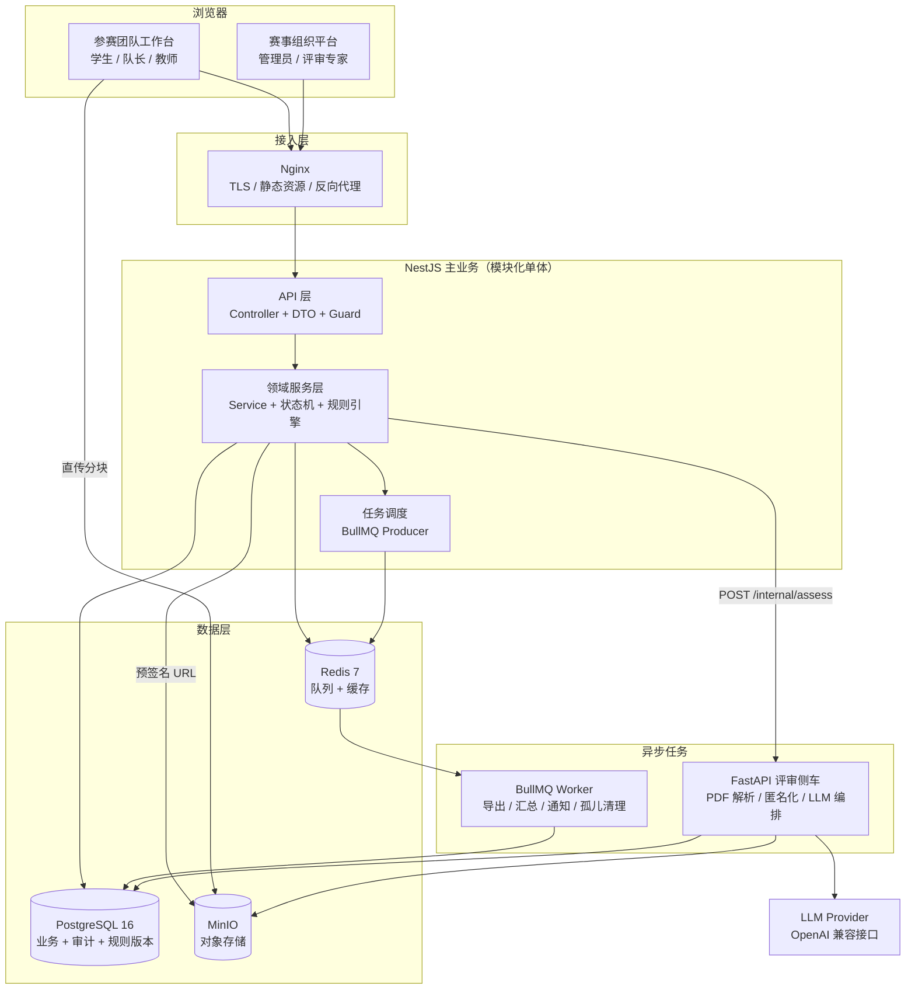

# 数学建模比赛管理系统 技术栈方案（TypeScript 版 · 已归档留档）

> **状态：已被 [纯 Python 方案](tech-stack-python.md) 取代。本文档仅作选型决策依据保留，不作为实施依据。**

> 版本：v1.0 ｜ 依据：[平台愿景初稿](../平台愿景初稿.md)、[系统边界](../boundary.md)、[功能需求](../functional-requirements.md)（FR-001～FR-028）、[业务对象](../../experiments/exp2-业务对象识别与用例图建模/business_objects.md)（17 个业务对象）
> 团队规模：2 人 ｜ 部署规模：校内/校际，单机或小集群 ｜ 课程节奏：实验三～实验六（人机协同开发）

---

## 0. 结论速览

采用 **模块化单体（Modular Monolith）+ 前后端分离**，形态为「**NestJS 主业务 + Python 评审侧车**」：

| 层 | 选型 |
|---|---|
| 前端 | React 18 + Vite 5 + TypeScript + Ant Design 5 + TanStack Query |
| 后端主业务 | NestJS 10（Node 20 LTS）+ Prisma 5 |
| 评审侧车 | FastAPI + Pydantic v2 + LLM 适配层 |
| 数据库 | PostgreSQL 16 |
| 缓存/队列 | Redis 7 + BullMQ |
| 对象存储 | MinIO（S3 兼容） |
| 部署 | Docker Compose + Nginx |

**不采用**：微服务/K8s、MongoDB、Electron 桌面端、低代码平台。理由见 [§8](#8-明确排除的方案)。

---

## 1. 架构总览



### 1.1 为什么是「主业务 + 评审侧车」而不是单栈

| 判断依据 | 结论 |
|---|---|
| 匿名评审需要拆解 PDF 页眉页脚、提取正文块 | `PyMuPDF` / `python-docx` 生态在 Python，Node 侧同等能力弱 |
| AI 预评级需要结构化输出校验、重试、限流 | `Pydantic v2` + `instructor` 模式成熟度更高 |
| 主业务是重度 CRUD + 状态机 + RBAC | NestJS 的 `Module/Guard/Interceptor` 与实验三类图一一对应 |
| 两个服务只通过 2 个内部接口耦合 | 耦合成本可控，符合单体优先原则 |

若团队无法承担双服务运维，**降级方案**：全 Python（FastAPI + React），见 [§9](#9-备选方案纯-python-单栈)。

---

## 2. 前端技术栈

| 项 | 选型 | 版本 | 理由 |
|---|---|---|---|
| 框架 | React | 18.3 | 生态最稳，AI 生成代码质量最高 |
| 构建 | Vite | 5.4 | 冷启动秒级，实验演示友好 |
| 语言 | TypeScript | 5.4 | 前后端共享类型，AI 生成时编译期纠错 |
| 组件库 | Ant Design | 5.x | 表格/表单/上传/时间线为密集型后台的刚需 |
| 数据请求 | TanStack Query | 5.x | 缓存失效、轮询、乐观更新开箱可用 |
| 路由 | React Router | 6.x | 角色路由 + 权限守卫 |
| 图表 | ECharts | 5.x | 评审进度看板、成绩分布、统计报表 |
| 表单校验 | React Hook Form + Zod | 7.x / 3.x | 与后端 DTO 共享 Zod schema（可选） |
| 富文本 | 不引入 | — | 公告用 Markdown 渲染（`react-markdown`）即可，降低 XSS 面 |
| 测试 | Vitest + Playwright | 1.x / 1.4x | 关键链路冒烟（登录→报名→提交→评审→发布） |
| 代码规范 | ESLint + Prettier + Stylelint | — | 实验四代码评审的基线 |

### 2.1 双使用面拆分

```
apps/web/
├── src/
│   ├── app/                   # 路由装配、全局 Provider、错误边界
│   ├── features/
│   │   ├── auth/              # 登录注册、角色路由
│   │   ├── competition/       # 赛事中心、赛事介绍、通知公告、参赛咨询
│   │   ├── enrollment/        # 报名、队伍管理、成员与指导教师绑定
│   │   ├── submission/        # 上传分块、版本列表、截止倒计时、提交回执
│   │   ├── review/            # 评审工作台、匿名材料阅读器、评分表
│   │   ├── result/            # 我的成绩、成绩单、排名、评语
│   │   ├── appeal/            # 申诉单、处理进度
│   │   ├── profile/           # 个人中心、我的竞赛（关注/已报名/比赛中/已结束）
│   │   └── admin/             # 赛事配置、评审分配、进度看板、审计查询、导出归档
│   ├── shared/                # 组件、hooks、API client、类型定义
│   └── styles/                # 主题 token、Ant Design 主题覆盖
```

**关键组件设计**

| 组件 | 职责 | 注意点 |
|---|---|---|
| `SubmissionUploader` | MD5 预检 → 分块上传 → 完成校验 | 必须支持断点续传与秒传提示 |
| `AnonymousMaterialViewer` | 渲染评审专家看到的匿名材料 | 只渲染服务端投影 DTO，前端不得持有队伍信息 |
| `ScoreForm` | 动态渲染评分表（RubricProfile） | 分值范围由服务端 schema 下发，前端只做即时反馈 |
| `LifecycleTimeline` | 赛事阶段与时间节点 | 数据来自服务端，禁止前端推导阶段 |
| `AuditDiffTable` | 审计日志前后值对比 | 用 `json-diff` 渲染，只读 |

---

## 3. 后端技术栈（主业务 · NestJS）

| 项 | 选型 | 版本 | 理由 |
|---|---|---|---|
| 运行时 | Node.js | 20 LTS | 长期支持，非 EOL |
| 框架 | NestJS | 10.x | 模块化分层与实验三 OOD 类图直接映射 |
| ORM | Prisma | 5.x | schema 驱动迁移、类型自动生成 |
| 校验 | class-validator + class-transformer | 0.14 / 0.5 | 与 DTO 天然集成 |
| 鉴权 | `@nestjs/passport` + JWT + 自定义 `PolicyGuard` | — | 角色 × 赛事 × 对象三层鉴权 |
| 密码 | `argon2` | — | 优于 bcrypt，无 72 字节限制 |
| 队列 | BullMQ | 5.x | 基于 Redis，任务可观测 |
| 缓存 | `@nestjs/cache-manager` + Redis Store | — | 结果页热点数据 |
| 文档 | `@nestjs/swagger` | 7.x | 自动 OpenAPI，前端类型由此生成 |
| 日志 | `pino` + `nestjs-pino` | — | 结构化日志，低成本，便于审计关联 |
| 导出 | `exceljs` + `archiver` | — | CSV/XLSX 与归档包 |
| 测试 | Jest + Supertest | 29 / 7 | 单元 + e2e |

### 3.1 模块划分（对应 17 个业务对象）

```
apps/api/src/
├── modules/
│   ├── identity/          # User, Role, AdvisorBinding
│   ├── competition/       # Competition, RuleProfile, Announcement, ProblemSet
│   ├── enrollment/        # Team, Enrollment
│   ├── submission/        # SubmissionAsset, SubmissionVersion, blob 抽象
│   ├── review/            # ReviewTask, RubricProfile, ScoreRecord, 匿名投影
│   ├── assessment/        # AIPreAssessment, ReviewEscalation, 侧车客户端
│   ├── result/            # CompetitionResult, Award, 汇总计算
│   ├── appeal/            # Appeal
│   ├── audit/             # AuditLog 切面、ArchiveRecord
│   └── notification/      # 站内通知 + 外部通道适配器
├── common/
│   ├── guards/            # JwtAuthGuard, RolesGuard, PolicyGuard
│   ├── interceptors/      # AuditInterceptor, TraceInterceptor
│   ├── filters/           # 全局异常映射（业务错误码）
│   └── state-machine/     # 转换表驱动 + 版本化
├── infra/
│   ├── prisma/            # PrismaService, 事务封装
│   ├── storage/           # StorageProvider: LocalDisk | MinIO
│   ├── queue/             # BullMQ 注册
│   └── llm-client/        # 侧车调用（超时、重试、熔断）
└── main.ts
```

---

## 4. 评审侧车技术栈（AI 预评级）

| 项 | 选型 | 版本 | 理由 |
|---|---|---|---|
| 框架 | FastAPI | 0.115+ | 异步、OpenAPI 自动生成 |
| 运行时 | Python | 3.11+ | 与仓库现有产品包一致 |
| 校验 | Pydantic | v2 | 结构化输出强校验 |
| PDF 解析 | PyMuPDF | 1.24+ | 拆页、提取文本块、定位页码 |
| DOCX 解析 | python-docx | 1.2 | 附件提取 |
| 图片 OCR | 暂不集成 | — | 首版仅标记「需人工核实」 |
| HTTP | httpx | 0.27+ | 异步调用 LLM |
| 限流/重试 | tenacity + 自研令牌桶 | — | 成本可控 |
| 存储 | SQLAlchemy 2.0（只读视图）或直连只读账号 | — | 回写评估结果 |
| 测试 | pytest | 8.x | 结构化解码与降级路径单测 |

### 4.1 侧车只做四件事

| 能力 | 输入 | 输出 | 落表 |
|---|---|---|---|
| 文档匿名化 | `blobId` | 去除身份信息的页文本块 | 不落表，临时产物 |
| 结构完整性粗评 | 页文本块 | 轻量特征（章节齐备度、图表数、公式数） | `ai_pre_assessment` |
| LLM 深度预评级 | 页文本块 + RubricProfile | 各维度参考分 + 证据引用 + 风险标记 | `ai_pre_assessment` |
| 复审触发判定 | 多人评分 + AI 参考分 + 规则版本 | 升级记录 | `review_escalation` |

**明确不做**：不做最终成绩计算、不做获奖判定、不做申诉裁决。AI 分数 `authority = ADVISORY`，永不进入最终加权公式。

### 4.2 结构化解码契约

```python
class Evidence(BaseModel):
    page: int = Field(ge=1)
    quote: str = Field(min_length=4, max_length=300)

class DimensionScore(BaseModel):
    code: Literal["problem", "model", "solution", "validity", "writing"]
    score: float = Field(ge=0, le=100)
    evidence: list[Evidence] = Field(min_length=1)   # 无证据即判无效

class PreAssessment(BaseModel):
    dimensions: list[DimensionScore] = Field(min_length=5, max_length=5)
    confidence: float = Field(ge=0, le=1)
    risk_flags: list[RiskFlag] = []
```

校验失败 → 状态置 `FAILED` + 保留原始输出，**不降级为「用自由文本凑」**。

---

## 5. 数据库技术栈

| 项 | 选型 | 版本 | 理由 |
|---|---|---|---|
| 主库 | PostgreSQL | 16 | 事务、JSONB、唯一约束、行级锁齐全 |
| 迁移 | Prisma Migrate（主业务）/ Alembic（侧车只读） | — | 单一迁移权威：仅主业务建表 |
| 连接池 | Prisma 内置 + PgBouncer（可选） | — | 单机可省 |
| 备份 | `pg_dump` 定时 + 归档包导出 | — | 对应 FR-025 |
| 字符集 | UTF8 | — | 中文赛事名与评语 |

### 5.1 六大约束（必须建索引）

```sql
-- 防重复报名
UNIQUE (competition_id, team_name)
UNIQUE (competition_id, user_id)          -- 一人在同一赛事只能进一队
-- 防重复评审
UNIQUE (task_id, reviewer_id)
-- 版本唯一
UNIQUE (asset_id, version_no)
-- 秒传判定
UNIQUE (md5, size_bytes)
-- AI 评估幂等 + 缓存
UNIQUE (version_id, model_id, prompt_version, input_hash)
```

没有这六个索引，压测时应用层查重会成为瓶颈（详见 [§7](#7-压力测试要点)）。

### 5.2 表分组

| 分组 | 主要表 | 关键设计 |
|---|---|---|
| 身份 | `user`, `role`, `user_role`, `advisor_binding` | 角色多对多，最小授权 |
| 赛事 | `competition`, `rule_profile`, `announcement`, `problem_set` | 规则版本快照，变更不溯及历史成绩 |
| 报名 | `team`, `team_member`, `enrollment` | 唯一约束 + 人数上限校验 |
| 提交 | `blob_object`, `submission_asset`, `submission_version` | 文件与业务解耦，`ref_count` 引用计数 |
| 评审 | `review_task`, `rubric_profile`, `score_record` | `source` + `authority` 双字段区分 AI/人工/复审 |
| AI | `ai_pre_assessment`, `review_escalation` | 幂等键 + 触发规则可追溯 |
| 结果 | `competition_result`, `award`, `result_version` | 汇总可重算，修订留版本 |
| 申诉 | `appeal`, `appeal_action` | 状态机 + 处理记录 |
| 审计 | `audit_log`, `archive_record` | **只 INSERT**，DB 层不给 UPDATE/DELETE |

### 5.3 审计表设计（FR-012 / FR-024）

```sql
CREATE TABLE audit_log (
  log_id         BIGSERIAL PRIMARY KEY,
  competition_id UUID,
  object_type    TEXT NOT NULL,
  object_id      TEXT NOT NULL,
  action         TEXT NOT NULL,
  before_json    JSONB,
  after_json     JSONB,
  operator_id    UUID NOT NULL,
  operator_role  TEXT NOT NULL,
  reason         TEXT,                    -- 高风险动作必填
  trace_id       TEXT,
  created_at     TIMESTAMPTZ NOT NULL DEFAULT now()
);
CREATE INDEX idx_audit_competition ON audit_log (competition_id, created_at DESC);
CREATE INDEX idx_audit_object ON audit_log (object_type, object_id);
```

**实现要点**

1. 应用账号对该表只有 `INSERT` 与 `SELECT`，无 `UPDATE` / `DELETE`。
2. 改分、换专家、发布结果、改权限四类动作，`reason` 为空则拒绝提交。
3. 导出与归档把该表一并打包（FR-025）。

---

## 6. 基础设施与工程化

| 项 | 选型 | 说明 |
|---|---|---|
| 容器 | Docker + Docker Compose | 单机一键起，课程演示友好 |
| 反向代理 | Nginx | TLS、静态资源、`/api` 与 `/assess` 分流 |
| 对象存储 | MinIO | S3 兼容，后期可无改切换云存储 |
| 缓存/队列 | Redis 7 | `maxmemory-policy noeviction`，队列不可丢失 |
| CI（可选） | GitHub Actions | lint + test + build 三段 |
| 环境配置 | `.env` + `zod` / `pydantic-settings` 校验 | 启动即校验，缺项直接失败 |
| 日志 | pino（主）/ structlog（侧车） | 统一 `traceId` 贯通两个服务 |
| 监控 | 简易 `/health` + 关键指标上报 | 课程规模不引入 Prometheus |

### 6.1 docker-compose 拓扑

```yaml
services:
  nginx:      # 80/443
  api:        # NestJS，2 个实例可选
  worker:     # BullMQ
  assessor:   # FastAPI 侧车
  postgres:   # 16
  redis:      # 7
  minio:      # 对象存储
```

起步配置：2 vCPU / 4 GB 可跑通全链路；生产建议 4 vCPU / 8 GB。

---

## 7. 压力测试要点

### 7.1 负载模型

| 场景 | 峰值形态 | 压力点 | 应对 |
|---|---|---|---|
| 报名截止前 30 分钟 | 500–2000 队集中提交 | 唯一约束冲突、连接池 | 唯一索引 + 乐观重试 |
| 提交截止前 1 小时 | 分块并发上传 | 对象存储 I/O | 预签名直传，应用只收元数据 |
| 评审截止前 2 小时 | 数十专家批量提交 | 写事务 + 汇总计算 | 汇总异步化，结果落表 |
| 成绩发布瞬间 | 全校刷新结果页 | 读放大 | 结果页缓存 + ETag |
| AI 预评级全量 | 每题一次 LLM 调用 | 预算与限流 | 两级策略：粗筛 → 深评 |

### 7.2 与文件无关的瓶颈（文件已通过 MD5 预检 + 异步慢传移出关键路径）

1. **唯一约束**：三处核心唯一索引必须存在。
2. **汇总计算**：必须异步 + 结果表，禁止请求时现算。
3. **LLM 预算**：200 队 × 2 万 token ≈ 400 万 token/轮，必须粗筛后再深评。
4. **Redis 不存会话**：JWT 无状态，Redis 只做队列与缓存。

### 7.3 压测工具

| 层 | 工具 | 关注指标 |
|---|---|---|
| HTTP 接口 | `k6` 或 `locust` | P50/P95/P99、错误率 |
| 数据库 | `pgbench` + `pg_stat_statements` | 慢查询、锁等待 |
| 队列 | BullMQ Board | 积压深度、任务耗时分布 |
| 长稳压测 | 30 分钟以上 | RSS 曲线（Node 内存泄漏 / Python worker 增长） |

---

## 8. 明确排除的方案

| 方案 | 排除理由 |
|---|---|
| 微服务 / K8s / 服务网格 | 3 人组、6 次实验，运维成本远超收益，评分不加分 |
| MongoDB | 一赛事一队、专家回避、版本唯一等强约束是关系型需求 |
| Electron 桌面端 | 多角色在线评审要求各自登录，桌面端形态冲突 |
| 低代码平台 | 无法体现 OOD 类图与代码评审，实验三后全部断层 |
| Spring Boot + Thymeleaf 全栈 | 无法产出「人机协同 AI 代码生成」的体面产物，学习曲线最陡 |
| 直接把 AI 分数纳入最终成绩 | 申诉时无法自证，属于评审合规风险（见 [§10](#10-ai-预评级的设计边界)） |

---

## 9. 备选方案（纯 Python 单栈）

| 层 | 选型 |
|---|---|
| 后端 | FastAPI + Pydantic v2 + SQLAlchemy 2.0（**全 async**）+ Alembic |
| 前端 | React 18 + Vite 5 + Ant Design 5 |
| 队列 | Celery + Redis（或 ARQ） |
| 复用 | 仓库 `products/math-modeling-paper-review` 的 `pyproject.toml` 依赖、Vite 脚手架、Pydantic 校验范式 |

**采纳条件**：团队更熟悉 Python，或实验五、六要深度扩展 AI 能力。

**硬性要求**：第一天就定全 async 栈（`asyncpg` + SQLAlchemy async），不得先用同步会话「跑起来再说」——同步会话混 async 路由会阻塞事件循环，压测表现为并发超过 50 后延迟线性上升。

---

## 10. AI 预评级的设计边界

| 原则 | 具体做法 |
|---|---|
| AI 是路由器，不是评委 | 预评分 `authority = ADVISORY`，不进入最终加权公式 |
| 边界判定用规则，不用模型 | `review_escalation` 由确定性规则产生，阈值进 `rule_profile` 可版本化 |
| 防锚定 | 默认向专家隐藏 AI 分数，只展示风险标记清单 |
| 可复现 | `(versionId, modelId, promptVersion, inputHash)` 唯一键保证幂等 |
| 失败可降级 | `FAILED` 状态进入「无 AI 参考」模式，人工流程照常 |
| 输出强校验 | Pydantic 校验失败即失败，不降级为自由文本 |

### 10.1 复审触发规则（初始值）

| 规则 | 触发条件 | 动作 |
|---|---|---|
| `SCORE_GAP` | 任意两位专家总分差 > 15 | 第三位专家盲评 |
| `AI_HUMAN_GAP` | 专家均分与 AI 参考分差 > 20 | 要求补充评分理由 |
| `LOW_CONFIDENCE` | AI 置信度 < 0.6 且处于奖项边界 | 专家组复核 |
| `RISK_CONFIRMED` | 专家确认 AI 标出的风险项 | 强制复审 + 规范审查 |
| `AWARD_BOUNDARY` | 总分落在奖项分界 ±3 分内 | 自动进入复审队列 |

---

## 11. 需求覆盖对照

| 需求 | 落点 |
|---|---|
| FR-001～005 赛事管理 | `competition` 模块 + 状态机 |
| FR-006～008 报名审核 | `enrollment` 模块 + 唯一约束 |
| FR-009～011 提交与截止锁定 | `submission` 模块 + 三段式上传 |
| FR-012～018 评审执行 | `review` + `assessment` 模块 + 匿名投影 |
| FR-019～021 成绩与发布 | `result` 模块 + 异步汇总 |
| FR-022～025 申诉与归档 | `appeal` + `audit` 模块 |
| FR-026～028 统计与协作 | `admin` 前端 + `notification` 模块 |
| NFR-02 安全 | PolicyGuard + 匿名投影 + 审计表 |
| NFR-04 可追溯 | `audit_log` + 规则版本 + AI 评估幂等键 |

---

## 12. 实施顺序

| 阶段 | 交付 | 验收 |
|---|---|---|
| 实验三 | 技术选型说明、部署图、模块划分、类图 | `docker compose up` 起全链路，鉴权接口通 |
| 第 11–12 周 | 状态机 + 审计切面 + RBAC Guard | 非法迁移被拒、审计可查 |
| 实验四 | 报名 + 提交版本链路（上传走 Mock 存储） | 唯一约束生效、截止锁定正确 |
| 实验五 | 匿名评审 + AI 预评级侧车接入 + 结构化解码 | 降级路径可用、幂等生效、成本可统计 |
| 实验六 | 复审规则引擎 + 申诉 + 导出归档 | 规则可配置、归档只读、审计完整 |

---

## 附录 A：关键依赖版本清单

```jsonc
// package.json（apps/api）
{
  "@nestjs/common": "^10.4.0",
  "@nestjs/core": "^10.4.0",
  "@nestjs/swagger": "^7.4.0",
  "@nestjs/passport": "^10.0.3",
  "@prisma/client": "^5.19.0",
  "bullmq": "^5.12.0",
  "class-validator": "^0.14.1",
  "argon2": "^0.41.1",
  "pino": "^9.4.0",
  "exceljs": "^4.4.0",
  "archiver": "^7.0.1"
}
```

```toml
# pyproject.toml（services/assessor）
[project]
requires-python = ">=3.11"
dependencies = [
  "fastapi>=0.115,<1",
  "pydantic>=2.7,<3",
  "pydantic-settings>=2.4,<3",
  "PyMuPDF>=1.24,<2",
  "python-docx>=1.1,<2",
  "httpx>=0.27,<1",
  "tenacity>=9,<10",
  "SQLAlchemy>=2.0,<3",
  "asyncpg>=0.29,<1",
  "structlog>=24,<25",
]
```

## 附录 B：环境变量清单（`.env.example`）

| 变量 | 说明 |
|---|---|
| `DATABASE_URL` | PostgreSQL 连接串 |
| `REDIS_URL` | 队列与缓存 |
| `JWT_SECRET` / `JWT_TTL` | 鉴权 |
| `S3_ENDPOINT` / `S3_BUCKET` / `S3_ACCESS_KEY` / `S3_SECRET_KEY` | 对象存储 |
| `UPLOAD_CHUNK_SIZE` / `UPLOAD_SESSION_TTL` | 分块上传 |
| `ASSESSOR_BASE_URL` / `ASSESSOR_TOKEN` | 侧车内部凭据 |
| `LLM_BASE_URL` / `LLM_API_KEY` / `LLM_MODEL` | 模型接入 |
| `LLM_MAX_TOKENS` / `LLM_TIMEOUT_MS` / `LLM_DAILY_BUDGET_CENTS` | 成本与限流 |
| `REVIEW_GAP_THRESHOLD` 等 | 复审规则的默认值（最终以 `rule_profile` 为准） |
