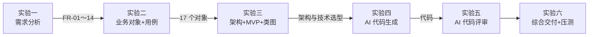

# experiments · 实验交付物

> 比赛管理系统方向下 6 次实验的全部交付物。每次实验一个目录。

---

## 进度

| 实验 | 主题 | 目录 | 状态 |
|---|---|---|---|
| 一 | 功能性需求分析 | [exp1-功能性需求分析](exp1-功能性需求分析/README.md) | ✅ 完成 |
| 二 | 业务对象识别与用例图建模 | [exp2-业务对象识别与用例图建模](exp2-业务对象识别与用例图建模/README.md) | ✅ 完成 |
| 三 | OOD 系统架构 / MVP / 类图 | [exp3-OOD架构与MVP](exp3-OOD架构与MVP/) | ⬜ 待开始 |
| 四 | 人机协同开发 · AI 代码生成 | `exp4-AI代码生成/` | ⬜ 未开始 |
| 五 | 人机协同开发 · AI 代码评审 | `exp5-AI代码评审/` | ⬜ 未开始 |
| 六 | 人机协同开发 · 综合交付 | `exp6-综合交付/` | ⬜ 未开始 |

---

## 每个实验目录的固定结构

```
expN-实验主题/
├── README.md              # 交付物索引、AI 使用声明、遗留问题
├── 实验N_xxx_两人组_比赛管理系统.docx   # 正式提交的报告
├── *.md                   # 过程文档（头脑风暴、访谈、需求表、SRS、分工）
├── *.puml                 # 图源文件（用例图、类图、时序图）
└── qa/                    # 自查产物（渲染 PDF、逐页截图），非提交内容
```

**为什么要有 README**：课程要求如实说明 AI 参与范围，而报告正文放不下太多过程细节。每份 README 的「AI 参与范围声明」一节可以直接引用到报告里，避免每学期重复解释。

---

## 实验之间的依赖



每次实验**不得更换命题**。实验二的业务对象直接决定实验三的类图，实验三的架构决定实验四的代码组织方式。

---

## 已经暴露的跨实验遗留问题

写后续实验时需要针对性处理，别让它累积：

| 来源 | 问题 | 应在何时解决 |
|---|---|---|
| 实验一 | 需求表从 14 条演进到 28 条（FR-001～FR-028），实验一版本未覆盖申诉、导出、统计 | 实验三补齐架构落点 |
| 实验一 | 原型只有首页，个人中心四态与评审工作台无原型 | 实验三的 MVP 设计 |
| 实验二 | `CollaborationNote` 边界模糊：队员之间还是管理员与队伍之间 | 实验三类图 |
| 实验二 | `ReviewTask` 与 `ScoreRecord` 是否合并 | 实验三权衡 |
| 实验二 | **匿名评审的映射关系未建模**（专家看到的材料 ↔ 真实 `SubmissionVersion`） | 实验三必须补，叫 `materialRef` |

---

## 提交前自查清单

每个实验提交前过一遍：

- [ ] 报告 docx 用课程模板，封面姓名学号齐全
- [ ] 所有 `.md` 过程文档与报告正文的结论一致（数字、数量、命名）
- [ ] `.puml` 能正常渲染，图片已嵌入报告
- [ ] `ai_log.md` 记录了实际用过的提示词（不是事后补写）
- [ ] `ai_audit.md` 说明了人工核对发现了什么、改了什么
- [ ] README 的「AI 参与范围声明」与实际情况一致
- [ ] 没有虚构内容（访谈记录、投票数、点击量、原型链接）
